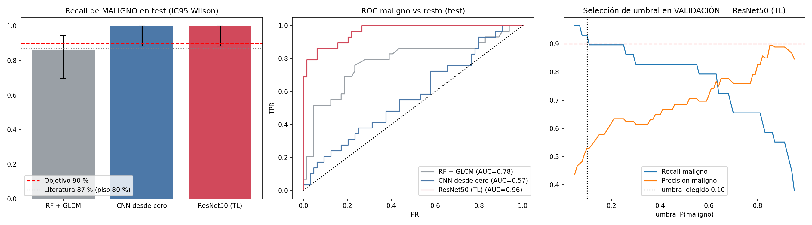
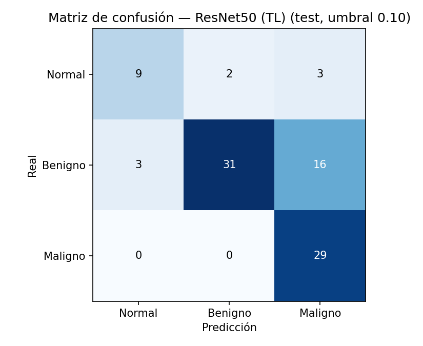
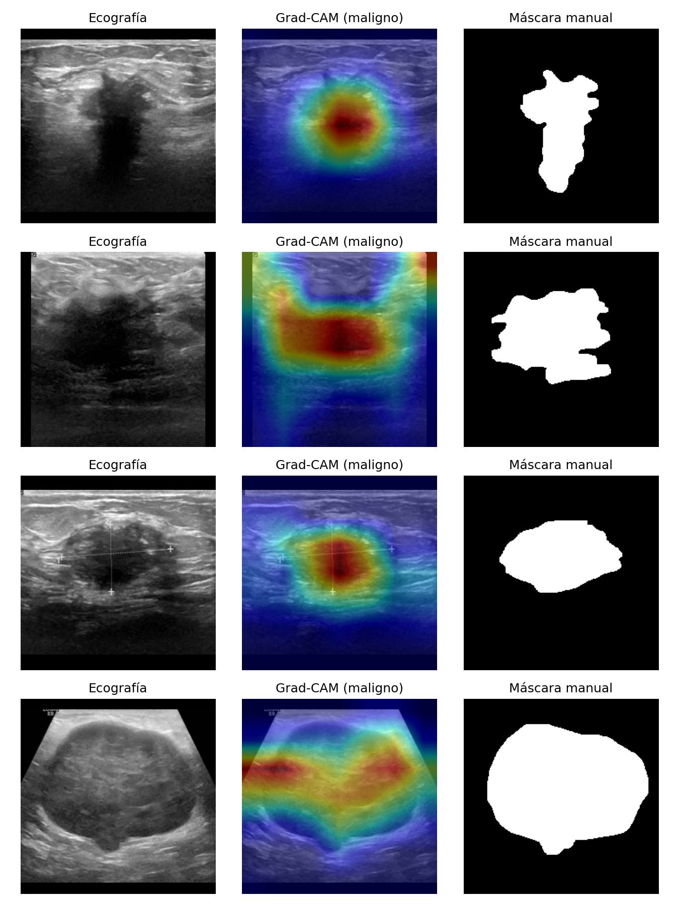

# 🩺 Breast Ultrasound Classification with Deep Learning · Clasificación de Ecografías Mamarias (BUSI)
 
[🇬🇧 Read in English](#en) | [🇦🇷 Leer en Español](#es)
 
[](https://www.python.org/)
[](https://www.tensorflow.org/)
[](https://scikit-learn.org/)
[](https://opencv.org/)
[](https://colab.research.google.com/)
[-20BEFF?style=flat&logo=kaggle&logoColor=white)](https://www.kaggle.com/datasets/aryashah2k/breast-ultrasound-images-dataset)
[](LICENSE.md)
[](LICENSE.md)
[](#disclaimer--aviso)
 
---
 
<a id="en"></a>
## 🇬🇧 English Version
 
### 👥 Authors
Juan Ignacio Matarrese · Jonathan Perez Laurinavicius · Horacio Bonafina — Group 38, UTN BA.

### 📌 Overview
Final project (Group 38) of the *Diploma in Data Science and Advanced Analytics* (UTN BA). It classifies breast ultrasound images into **Normal / Benign / Malignant** and is framed as a *second-opinion tool to prioritise suspicious cases*. The guiding criterion, fixed before training, is **Recall of the Malignant class ≥ 90 %** (minimise false negatives); among the models that meet it, the one with the highest Precision is chosen. The model and the decision threshold are selected on the validation set and the test set is used **only once**.
 
The project follows **CRISP-DM** and compares three approaches: a Random Forest on GLCM texture features, a CNN trained from scratch and a ResNet50 with Transfer Learning. Grad-CAM maps are compared against the manual lesion masks provided by the dataset.
 
### 🏆 Key Results (test set: 93 images, 29 malignant)
| Model | Malignant Recall (95 % CI) | Malignant Precision | AUC-ROC (malignant) |
|---|---|---|---|
| Random Forest + GLCM | 0.86 (0.69–0.95) | 0.35 | 0.78 |
| CNN from scratch † | 1.00 (0.88–1.00) | 0.31 | 0.57 |
| **ResNet50 (Transfer Learning)** | **1.00 (0.88–1.00)** | **0.60** | **0.96** |
 
† Flags every study as malignant (equivalent to the trivial "always malignant" model) and was unstable between runs.
 
- The ResNet50 is the only model with usable Precision at the target Recall; however, the lower bound of its Recall CI (0.88) is below 0.90 and its Precision is below the 0.75 orientative floor. With only 29 malignant cases, this is a **proof of concept, not a clinical validation**.
- Reference comparison: pooled ultrasound sensitivity of 87 % (95 % CI 80–92 %; Azarpey, 2023). The intervals overlap, so statistical superiority is **not** claimed.
### 🧭 Methodology
1. **Data:** BUSI dataset (780 images, 3 classes).
2. **Cleaning:** perceptual-hash (pHash, distance ≤ 4) de-duplication and removal of label-conflict groups: 780 → **619** images.
3. **Split:** stratified 70/15/15 (433 / 93 / 93), seed 42.
4. **Models:** Random Forest + 12 GLCM features · CNN (3 conv blocks) · ResNet50 (frozen head → fine-tuning of the last 30 layers, LR 1e-5, BatchNorm frozen, data augmentation).
5. **Imbalance:** class weights in the loss.
6. **Selection:** threshold tuned on validation to reach Recall ≥ 90 %; test reported once, with Wilson 95 % CIs.
7. **Interpretability:** Grad-CAM vs. manual masks.
### 📁 Project Structure
```
├── README.md
├── LICENSE.md
├── requirements.txt
├── TP_Final_Grupo38_ejecutado.ipynb   # notebook with the outputs of the run used in the report
├── resultados.json                    # every figure in the report comes from here
└── figuras/                           # figures generated by the notebook
    ├── eda_distribuciones.png
    ├── eda_ejemplos.png
    ├── redundantes_pares.png
    ├── conflicto_pares.png
    ├── evaluacion.png
    ├── matriz_confusion.png
    ├── gradcam.png
    └── gradcam_falsos_positivos.png
```
 
### ▶️ How to Run
1. `pip install -r requirements.txt` (Python 3.10+).
2. The dataset is downloaded automatically with `kagglehub`. If you already have it: `export BUSI_PATH=/path/to/Dataset_BUSI_with_GT`.
3. Open `TP_Final_Grupo38_ejecutado.ipynb` (it ships with the outputs of the run used in the report) and run all cells. CPU takes tens of minutes; a GPU is recommended (e.g. Google Colab).
4. Outputs: the `figuras/` folder and `resultados.json`.
Smoke test (only checks that the code runs, results are **not** valid): `MODO_PRUEBA=1 jupyter nbconvert --to notebook --execute TP_Final_Grupo38_ejecutado.ipynb`
 
**On Google Colab:** upload the notebook, *Runtime → Run all*, and download `resultados.json` and `figuras/` with the last cell.
 
### 🔁 Reproducibility
Fixed seed (42) for splits, Random Forest and TensorFlow. GPU training is not bit-for-bit deterministic, so results can vary slightly across hardware and TensorFlow versions: the report uses the run whose notebook (with outputs) and `resultados.json` are included here. Across two runs the ResNet50 stayed stable (Recall 1.00, Precision 0.60, AUC 0.96), while the from-scratch CNN did not.
 
### 📊 Visualizations
**Evaluation:** Malignant Recall with 95 % CI against the 90 % target and the literature reference, ROC curves, and threshold selection on validation.
 

 
**Confusion matrix (ResNet50, test, threshold 0.10):**
 

 
**Grad-CAM (malignant class) vs. manual masks:** the lesion receives more attention than chance in 86 % of malignant cases (mean energy 0.30 vs. mean lesion area 0.14). It is descriptive evidence on the test set, not a proof of causality.
 

 
🔗 More: [class distributions](figuras/eda_distribuciones.png) · [examples](figuras/eda_ejemplos.png) · [near-duplicate pairs](figuras/redundantes_pares.png) · [label-conflict pairs](figuras/conflicto_pares.png) · [false positives](figuras/gradcam_falsos_positivos.png)
 
### ⚠️ Limitations
Small, single-centre dataset without patient IDs (images of the same patient may be split across sets); only 29 malignant cases in test; one data partition for the networks; no cross-validation for the deep models (switch `CV_PROFUNDO` available); no external validation. The test malignant prevalence (31 %) does not represent population screening, so real-world Precision would be lower.
 
### 📚 References
- Al-Dhabyani, W., Gomaa, M., Khaled, H. & Fahmy, A. (2020). Dataset of breast ultrasound images. *Data in Brief*, 28, 104863.
- Azarpey, N. (2023). Sensitivity and specificity of ultrasound and mammography for detection of breast malignancy: a systematic review and meta-analysis. *Oncology and Radiotherapy*, 17(9), 333–339. Used as the external reference (sensitivity 87 %, 95 % CI 80–92 %; specificity 75 %, 61–84 %; 28 studies); the lower bound (80 %) is used as a conservative floor. It is a pooled estimate across readers and equipment, not an individual radiologist, so the comparison is indicative. The values are constants at the top of the notebook (`SENS_LIT`, `ESPEC_LIT`) and are saved in `resultados.json`.

---
 
<a id="es"></a>
## 🇦🇷 Versión en Español
 
### 👥 Autores
Juan Ignacio Matarrese · Jonathan Perez Laurinavicius · Horacio Bonafina — Grupo 38, UTN BA.

### 📌 Descripción General
Trabajo Final Integrador (Grupo 38) de la *Diplomatura en Ciencia de Datos y Análisis Avanzado* (UTN BA). Clasifica ecografías mamarias en **Normal / Benigno / Maligno** y se plantea como *herramienta de segunda opinión para priorizar casos sospechosos*. El criterio rector, fijado antes de entrenar, es **Recall de la clase Maligno ≥ 90 %** (minimizar falsos negativos); entre los modelos que lo cumplen se elige el de mayor Precision. Modelo y umbral se seleccionan en validación y el test se usa **una sola vez**.
 
El proyecto sigue **CRISP-DM** y compara tres enfoques: Random Forest sobre características de textura GLCM, una CNN desde cero y una ResNet50 con Transfer Learning. Los mapas Grad-CAM se contrastan con las máscaras manuales de lesión que trae el dataset.
 
### 🏆 Resultados Clave (test: 93 imágenes, 29 malignas)
| Modelo | Recall maligno (IC95) | Precision maligno | AUC-ROC (maligno) |
|---|---|---|---|
| Random Forest + GLCM | 0,86 (0,69–0,95) | 0,35 | 0,78 |
| CNN desde cero † | 1,00 (0,88–1,00) | 0,31 | 0,57 |
| **ResNet50 (Transfer Learning)** | **1,00 (0,88–1,00)** | **0,60** | **0,96** |
 
† Marca todos los estudios como malignos (equivale al modelo trivial "siempre maligno") y fue inestable entre ejecuciones.
 
- La ResNet50 es el único modelo con Precision utilizable al Recall objetivo; sin embargo, el límite inferior de su IC de Recall (0,88) queda bajo 0,90 y su Precision bajo el piso orientativo de 0,75. Con solo 29 casos malignos, es una **prueba de concepto, no una validación clínica**.
- Comparación con la referencia: sensibilidad combinada de la ecografía del 87 % (IC95 80–92 %; Azarpey, 2023). Los intervalos se solapan, por lo que **no** se afirma superioridad estadística.
### 🧭 Metodología
1. **Datos:** dataset BUSI (780 imágenes, 3 clases).
2. **Limpieza:** eliminación de casi-duplicados por perceptual hashing (pHash, distancia ≤ 4) y de grupos con etiquetas contradictorias: 780 → **619** imágenes.
3. **Partición:** estratificada 70/15/15 (433 / 93 / 93), semilla 42.
4. **Modelos:** Random Forest + 12 variables GLCM · CNN (3 bloques convolucionales) · ResNet50 (cabeza congelada → fine-tuning de las últimas 30 capas, LR 1e-5, BatchNorm congelada, data augmentation).
5. **Desbalance:** class weights en la función de pérdida.
6. **Selección:** umbral ajustado en validación para Recall ≥ 90 %; test reportado una sola vez, con IC95 de Wilson.
7. **Interpretabilidad:** Grad-CAM vs. máscaras manuales.
### 📁 Estructura del Proyecto
```
├── README.md
├── LICENSE.md
├── requirements.txt
├── TP_Final_Grupo38_ejecutado.ipynb   # notebook con las salidas de la ejecución usada en el informe
├── resultados.json                    # de acá salen todas las cifras del informe
└── figuras/                           # figuras generadas por el notebook
    ├── eda_distribuciones.png
    ├── eda_ejemplos.png
    ├── redundantes_pares.png
    ├── conflicto_pares.png
    ├── evaluacion.png
    ├── matriz_confusion.png
    ├── gradcam.png
    └── gradcam_falsos_positivos.png
```
 
### ▶️ Cómo Ejecutarlo
1. `pip install -r requirements.txt` (Python 3.10+).
2. El dataset se descarga solo con `kagglehub`. Si ya lo tenés: `export BUSI_PATH=/ruta/a/Dataset_BUSI_with_GT`.
3. Abrir `TP_Final_Grupo38_ejecutado.ipynb` (trae las salidas de la ejecución usada en el informe) y ejecutar todas las celdas. En CPU tarda decenas de minutos; se recomienda GPU (p. ej. Google Colab).
4. Salidas: carpeta `figuras/` y `resultados.json`.
Corrida de humo (solo verifica que el código corre, **no** da resultados válidos): `MODO_PRUEBA=1 jupyter nbconvert --to notebook --execute TP_Final_Grupo38_ejecutado.ipynb`
 
**En Google Colab:** subir el notebook, *Entorno de ejecución → Ejecutar todo*, y descargar `resultados.json` y `figuras/` con la última celda.
 
### 🔁 Reproducibilidad
Semilla fija (42) para particiones, Random Forest y TensorFlow. El entrenamiento en GPU no es bit a bit determinista, por lo que los resultados pueden variar levemente entre hardware y versiones de TensorFlow: el informe usa la ejecución cuyo notebook (con salidas) y `resultados.json` se incluyen acá. En dos ejecuciones la ResNet50 se mantuvo estable (Recall 1,00, Precision 0,60, AUC 0,96); la CNN desde cero no.
 
### 📊 Visualizations
**Evaluación:** Recall maligno con IC95 frente al objetivo del 90 % y la referencia de la literatura, curvas ROC y selección del umbral en validación.
 

 
**Matriz de confusión (ResNet50, test, umbral 0,10):**
 

 
**Grad-CAM (clase maligno) vs. máscaras manuales:** la lesión recibe más atención que el azar en el 86 % de los casos malignos (energía media 0,30 vs. área media de la lesión 0,14). Es evidencia descriptiva sobre el test, no prueba causalidad.
 

 
🔗 Más: [distribuciones](figuras/eda_distribuciones.png) · [ejemplos](figuras/eda_ejemplos.png) · [pares casi duplicados](figuras/redundantes_pares.png) · [pares con etiquetas en conflicto](figuras/conflicto_pares.png) · [falsos positivos](figuras/gradcam_falsos_positivos.png)
 
### ⚠️ Limitaciones
Dataset pequeño, de un solo centro y sin ID de paciente (imágenes de una misma paciente pueden quedar repartidas entre conjuntos); solo 29 malignos en test; una única partición para las redes; sin validación cruzada en las redes (interruptor `CV_PROFUNDO` disponible); sin validación externa. La prevalencia de malignos en test (31 %) no representa un tamizaje poblacional, por lo que la Precision real sería menor.
 
### 📚 Referencias
- Al-Dhabyani, W., Gomaa, M., Khaled, H. & Fahmy, A. (2020). Dataset of breast ultrasound images. *Data in Brief*, 28, 104863.
- Azarpey, N. (2023). Sensitivity and specificity of ultrasound and mammography for detection of breast malignancy: a systematic review and meta-analysis. *Oncology and Radiotherapy*, 17(9), 333–339. Se usa como referencia externa (sensibilidad 87 %, IC95 80–92 %; especificidad 75 %, 61–84 %; 28 estudios); el límite inferior (80 %) funciona como piso conservador. Es un promedio de estudios con distintos lectores y equipos, no un radiólogo individual, por lo que la comparación es orientativa. Los valores están como constantes al inicio del notebook (`SENS_LIT`, `ESPEC_LIT`) y se guardan en `resultados.json`.

---
 
<a id="disclaimer--aviso"></a>
## ⚕️ Disclaimer · Aviso
**🇬🇧** Academic project. It is **not a medical device** and does not replace the judgement of a radiologist. Any clinical use would require external validation and regulatory authorisation.
 
**🇦🇷** Proyecto académico. **No es un dispositivo médico** ni sustituye el criterio de un radiólogo. Cualquier uso clínico requeriría validación externa y autorización regulatoria.
